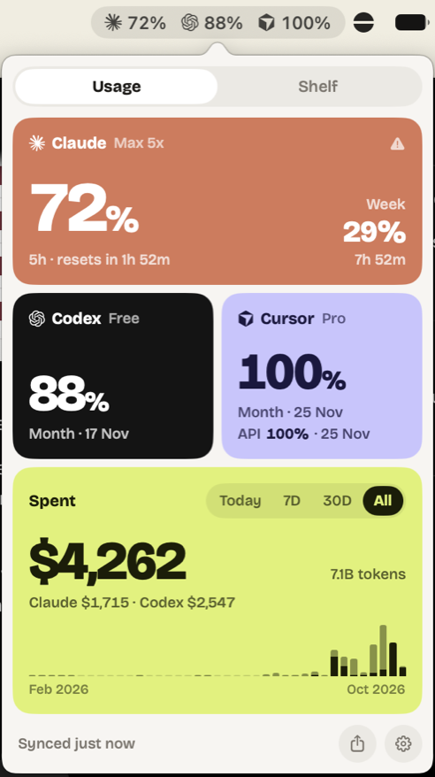

<div align="center">


# Burn

**See how much of your AI coding subscriptions you've burned through, right from the menu bar.**

Live rate limits for Claude Code, Codex and Cursor, plus what your usage would have cost at API prices.

[](https://github.com/noyex/burn/releases/latest)

[](LICENSE)

[**Download Burn.dmg**](https://github.com/noyex/burn/releases/latest/download/Burn.dmg)



</div>

## Features

- **Menu bar**: each provider's logo with what's left of its most-used limit. Turns orange at 20% left, red at 0%.
- **Limits**: every window the provider reports (Claude 5h / weekly, Codex, Cursor monthly / API) with reset times.
- **Usage**: cost, tokens and a per-provider chart for today, this week, this month and all time, computed locally from Claude Code and Codex session logs.
- **Share**: copies an image of your spend to the clipboard, ready to paste anywhere.
- **Settings**: choose which providers appear in the menu bar and which limit each one shows; launch at login.

Native SwiftUI + AppKit, no Electron, no dependencies, about 1 MB. Runs on Apple silicon and Intel.

## Install

You need macOS 14 or later and at least one of [Claude Code](https://claude.com/claude-code),
[Codex CLI](https://github.com/openai/codex) or [Cursor](https://cursor.com), signed in on this Mac.

### Option 1: one command (recommended)

```sh
curl -fsSL https://raw.githubusercontent.com/noyex/burn/main/install.sh | bash
```

Downloads the latest release into `/Applications`, replaces an older copy and starts Burn.
Run it again to update.

### Option 2: DMG

1. Download [**Burn.dmg**](https://github.com/noyex/burn/releases/latest/download/Burn.dmg), open it and drag Burn into Applications.
2. Open Burn. Burn isn't notarized by Apple, so the first time macOS says it can't verify the app.
   Click **Done**, then go to **System Settings → Privacy & Security** and click **Open Anyway** next to Burn.

<details>
<summary>Prefer the terminal for step 2?</summary>

```sh
xattr -d com.apple.quarantine /Applications/Burn.app && open /Applications/Burn.app
```

</details>

### Option 3: build from source

Needs the Xcode command line tools (Swift 6).

```sh
git clone https://github.com/noyex/burn.git
cd burn
scripts/build-app.sh --install   # builds Burn.app, copies it to /Applications and launches it
```

### First launch

Burn lives in the menu bar only, with no Dock icon. If macOS asks for access to the
`Claude Code-credentials` Keychain item, click **Always Allow**: that's how Burn reads Claude's limits.

## How it works

| What | Source |
|---|---|
| Claude limits | `api.anthropic.com/api/oauth/usage`, using Claude Code's token from the Keychain (`Claude Code-credentials`) |
| Codex limits | `chatgpt.com/backend-api/wham/usage`, using the token in `~/.codex/auth.json` |
| Cursor limits | `api2.cursor.sh` `DashboardService/GetCurrentPeriodUsage`, using Cursor's token |
| Usage & cost | Claude Code logs (`~/.claude/projects`) and Codex logs (`~/.codex/sessions`), imported incrementally into `~/Library/Application Support/Burn/usage.sqlite` |
| Prices | [LiteLLM's model price list](https://github.com/BerriAI/litellm/blob/main/model_prices_and_context_window.json), cached for 24 h (or T3 Code's copy, if installed) |

**Privacy**: tokens are only read, never refreshed or written, and only sent to the provider they
belong to. Usage data never leaves your Mac. Costs are estimates at API list prices, not what
your subscription actually charges.

Claude Code and Codex delete old session logs, so Burn keeps everything it has imported in its own
database: history builds up from the first launch on.

## Uninstall

Quit Burn from its settings, then:

```sh
rm -rf /Applications/Burn.app ~/Library/Application\ Support/Burn
```

## Development

```sh
swift build
.build/debug/Burn --dump     # print live limits and usage summaries
.build/debug/Burn --import   # run the log importer once and print timings
.build/debug/Burn --preview  # popover content in a plain off-screen window, for screenshots
```

Releasing: `scripts/release.sh v1.2.3` on an up-to-date `main` tags the commit, builds a universal
`Burn.dmg` and `Burn.zip` (`scripts/package.sh`) and publishes them as a GitHub release.

## License

MIT. Provider logos come from [Simple Icons](https://simpleicons.org) (CC0) and are trademarks of their owners.
Set in [Bricolage Grotesque](https://github.com/ateliertriay/bricolage) (SIL Open Font License, see `assets/Fonts/OFL.txt`).
